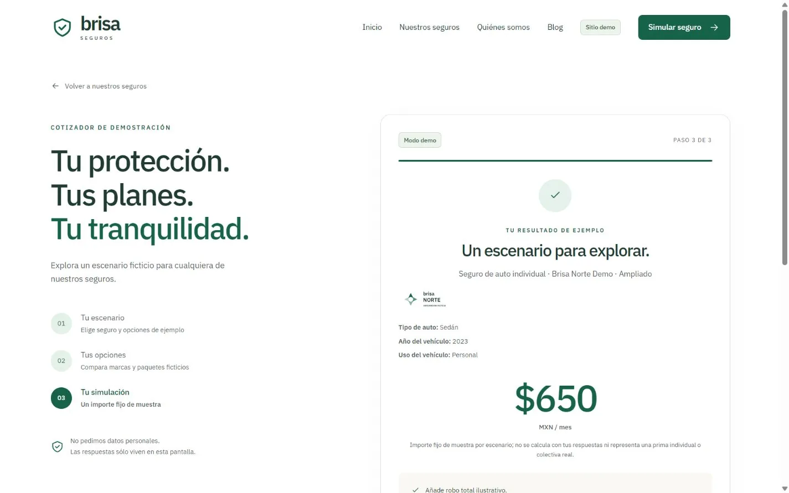
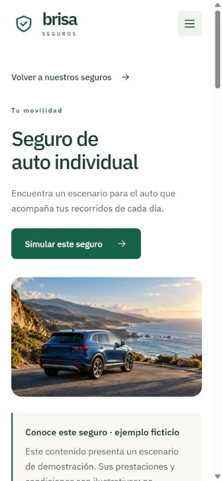
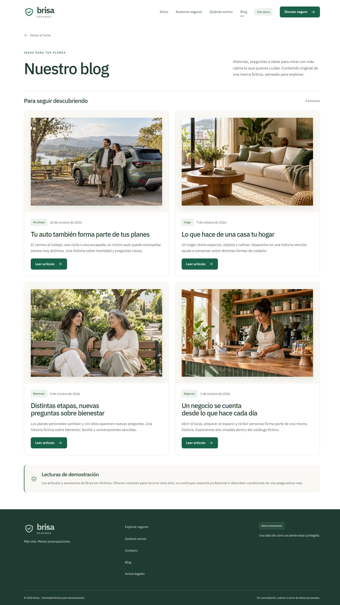

# Brisa · Una experiencia para explorar seguros

Brisa es un proyecto ficticio de portafolio que reúne un catálogo de seguros,
una simulación de cotización y contenido editorial en una misma experiencia.
Su propósito es mostrar cómo una interfaz puede acompañar a una persona desde
la exploración de un producto hasta un resultado de ejemplo, manteniendo
visibles los límites de la demostración.

[Ver demo](https://demo-brisa.fmejiadev.com/) ·
[Ver código](https://github.com/franciscomh58/brisa-seguros-demo)

## El reto

Un catálogo con necesidades personales y empresariales puede volverse difícil
de recorrer si cada producto utiliza una estructura distinta. El reto fue
organizar nueve seguros con una navegación reconocible, detalles propios y
un siguiente paso claro. El visitante debe entender qué está explorando y
poder probar el recorrido sin introducir información personal ni confundir
el resultado con una oferta comercial.

## La solución

La experiencia comienza con una portada centrada en una idea de protección
cercana. El catálogo conduce a nueve fichas con contenido específico,
preguntas frecuentes y acceso al cotizador. Desde una ficha, el seguro llega
preseleccionado para mantener el contexto de la navegación.

El cotizador comparte un recorrido de tres pasos: elegir un escenario,
seleccionar una aseguradora y un paquete, y revisar una simulación. Los campos
cambian según el producto. En auto, por ejemplo, aparecen tipo de vehículo,
año y uso. Tres aseguradoras ficticias y tres paquetes por seguro permiten
explorar alternativas sin recurrir a tarifas reales. El blog añade cuatro
artículos originales sobre movilidad, hogar, bienestar y negocios.

## Decisiones de implementación

El proyecto utiliza Angular standalone, TypeScript y Tailwind CSS, con
renderizado en el navegador. Los datos del catálogo y los componentes
compartidos mantienen una estructura consistente entre listados, fichas y
rutas. Un único cotizador concentra el flujo común y adapta las preguntas,
evitando mantener una pantalla independiente para cada seguro.

Las respuestas permanecen en memoria durante la interacción. Los importes
son valores fijos de muestra; no dependen de una evaluación de riesgo. Las
fotografías ilustrativas se sirven como WebP y los logos como SVG locales.
La paleta bosque, salvia y marfil acompaña el contenido sin competir con él.

## Experiencia y accesibilidad

La presentación combina jerarquías de texto claras, botones identificables
y una composición que se reorganiza en móvil. En la revisión de la versión
publicada se comprobó el foco visible al llegar por teclado al control de
movimiento, la pausa de la portada y el cierre del menú móvil con Escape,
con devolución del foco al botón. Los campos del escenario de auto tienen
etiquetas asociadas y el resultado conserva las selecciones realizadas.

Estas comprobaciones describen comportamientos concretos del recorrido
revisado; no equivalen a una certificación de accesibilidad. Las capturas
muestran el producto real en escritorio y en una ventana móvil.

## Resultado y límites

El resultado es una demostración navegable de exploración, simulación y
lectura. El repositorio público permite consultar su implementación y la
procedencia de los recursos. La entrega comunica decisiones técnicas y
comportamientos observables, sin atribuir métricas de conversión ni resultados
comerciales.

Brisa y sus aseguradoras son ficticias. No hay backend, persistencia de
respuestas, envío de formularios, contratación ni pagos; el contacto es
demostrativo. Al revisar el despliegue se detectó que el acceso directo al
cotizador devuelve un 404 de Azure. Mientras se corrige esa configuración,
el recorrido puede iniciarse desde la portada y continuar mediante los
enlaces internos del sitio.

[Volver a la ficha del proyecto](tarjeta.md)
