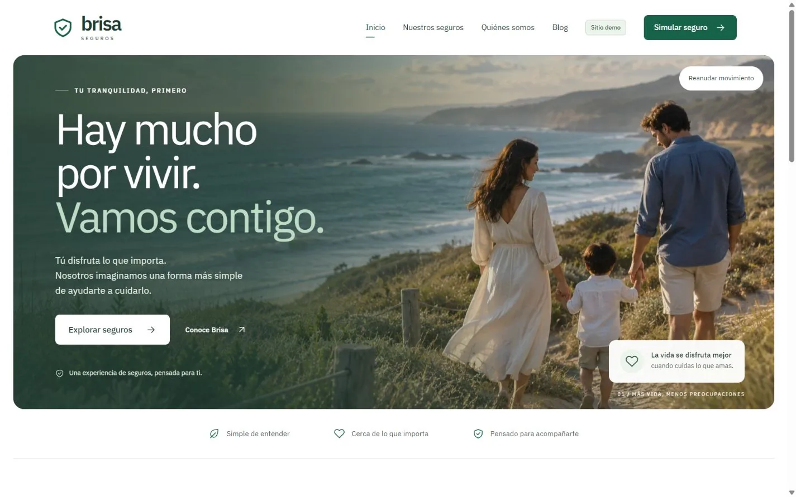

# Brisa · Demo de seguros

Experiencia web de seguros con nueve productos, un cotizador ficticio adaptable
y un blog original. Desarrollada con Angular y Tailwind CSS, con atención al
diseño responsive y la navegación accesible.

**Tecnologías:** Angular · TypeScript · Tailwind CSS.

[Ver caso de estudio](caso-de-estudio.md) ·
[Ver demo](https://delightful-wave-0788a5310.3.azurestaticapps.net/) ·
[Ver código](https://github.com/franciscomh58/brisa-seguros-demo)

Proyecto ficticio de portafolio. Las aseguradoras, escenarios e importes son
ejemplos de demostración.
